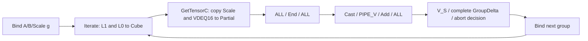

# Stage4U — bounded Matmul lifetime / overlap review

**Decision: `BLOCKED_OVERLAP_LIFECYCLE_UNPROVEN`. No new computation Kernel, OPP,
NPU run, Benchmark or Profile is created by this stage.** This is a failure to prove
safe cross-group overlap for the current contract, not a claim that the hardware
can never pipeline matrix operations. Stage4T can proceed independently.

Review scope: local CANN9.0.0, dav_2002, existing Stage4P GM INT8 A/B → Local NZ FP16,
CFG_NORM, one Matmul object,20 independent K128 groups, BaseN256. No N512,
GetCmpMask, deleted End/events/barriers, Workspace hoist or additional allocation.

## Identity and compilation boundary

`sdk-review.json` records the exact local root,17 fixed file paths, full SHA256,
line ranges and per-file server-identity status. Files matched against previous
user-provided hashes / Stage4F records say `MATCHES_PREVIOUS_SERVER_REVIEWED_SHA256`.
Others remain `LOCAL_ONLY_NOT_SERVER_VERIFIED`; there is no new assertion about
server libraries or the current server installation. Only metadata/analysis are
committed, never SDK text. The Stage4S PASS report alone is not promoted into a
new per-file server hash verification.

`compile_probe/interfaces.cpp` contains no `__global__` entry or main. The script
uses BiSheng `-fsyntax-only`, emits no object/Kernel/OPP and never launches anything.
It separately instantiates Iterate<true/false>, GetTensorC<true/false>, SetQuantVector,
End, and static-asserts `!CFG_NORM.enVecND2NZ` / `IsNeedUB()` for2002.
Actual local result: **INTERFACE_SYNTAX_ACCEPTED_LOCAL_ONLY**. An initial attempt
lacked the SDK's `kernel_tiling/kernel_tiling.h` compatibility include root; adding
existing `compiler/tikcpp/tikcfw` resolved it. No SDK files were edited or invented.
Syntax acceptance does not prove asynchronous behavior, buffer safety or performance.

## Findings with direct evidence

The source IDs below map to full paths and SHA256 in `sdk-review.json`.

1. **Current implementation, not generic API comments.** `interface:18–26,134–145`
   selects MatmulImpl for the non-split2002 path; `impl:24–39` derives from
   MatmulImplBase. `base:601–646` delegates Local GetTensorC to Scheduler.GetResult
   and Iterate to ScheduleOnce. These bodies **do not inspect the `sync` template
   parameter**. `Iterate(false)` passes `enPartialSum=false`; it does not select
   asynchronous mode. Changing only `<true>` to `<false>` exposes no different
   scheduler/completion mechanism in this reviewed path. Both signatures compiling
   is not a GO for overlap or a measurement of generated instructions.

2. **Scale is stateful and used at output time.** `quant:49–54` sets one GM tensor
   descriptor and VDEQF16 mode. `quant:113–124,143–160` obtains a local coefficient
   view at transLength, sets its size to baseN, waits MTE3_MTE2, copies GM coefficients,
   then waits MTE2_V before output setup. `copyout:245–294` emits16 NZ blocks, each
   using a128-byte coefficient address step. Therefore early SetQuantVector(g+1)
   before GetTensorC(g) has consumed its descriptor can select the wrong Scale.
   No per-group immutable coefficient snapshot or double-buffer contract was found.
   Empty QuantProcessor.Destroy (`quant:109–111`) does not authorize early reuse.

3. **Local output is enhanced DataCopy, not independent Cast+Mul or910B FixPipe.**
   `copyout:75–136` selects Local NZ and sequential destination layout;
   `datacopy_interface:1108–1121` marks INT32→half Local DataCopy as `__inout_pipe__(V)`;
   `datacopy_device:542–572` uses `copy_matrix_cc_to_ubuf` with
   `CRMODE_DEQSCALE_VDEQ16` on dav_m200 (separate Vector-only target rejected).
   The SDK pipeline annotation is evidence about this interface, not a decomposition
   of profiler time. It does not alone prove all external consumers can proceed
   without the currently accepted barriers.

4. **CO1 ownership and End have work beyond an API call.**
   `scheduler:93–108` allocates C when enPartialSum=false and computes;
   `scheduler_base:363–386` gets/enqueues/dequeues CO1, emits Local output and frees
   the CO1 tensor. `co1:35–81` maintains the CO1 queue and frees its events on Destroy.
   `scheduler_base:149–167` destroys input buffers, ends bias handling, calls L0 ResetCache (the reviewed non-cache base implementation is empty),
   destroys output/quant state (and conditional cross-core state).
   The L0 pool destructor waits/releases its ping/pong events; this is not the
   same operation as each per-group End. No End instruction-cost claim is made.
   SetTensorA/B reset input state and scheduler first-iteration state
   (`base:505–542`, `input:50–68`, `scheduler_reset:59–91`). Reset is not a completion
   fence. The supplied sources do not establish that End can be omitted for a new
   group with different A/B/Scale. Conversely, End is **not claimed to complete
   later user Cast/Add**. Preserve End and all accepted caller barriers.

5. **L0 double buffering is internal ownership, not spare public storage.**
   `scheduler:128–158,242–257` prepares inputs, allocates/enqueues/dequeues L0 buffers,
   issues Cube computation, then calls pool Free. `l0base:35–50,58–118` allocates the
   full A2/B2 pools; Allocate waits M_MTE1, EnQue/DeQue use MTE1_M, Free sets M_MTE1
   and advances ping/pong. `l0v200:30–54` initializes and eventually releases the
   corresponding events. `modules:95–113` binds these resource modules. These are
   SDK-internal mechanisms; no external API to take their ownership for the next
   independent group is demonstrated. CO1 queue internals are not reinterpreted as
   a user-visible asynchronous completion token.

6. **Scratch is deliberately reused by sequential phases.**
   `workspace:156–181,189–196,227–233,261–317` selects the non-vector-ND2NZ workspace,
   returns offset views, reserves `2*baseK*baseN` for non-transposed INT8 B conversion,
   and aliases phase storage within one supplied allocation. For this no-bias,
   VECIN NZ configuration the B conversion reservation is `[0,65536)`; coefficient
   view is `[34816,36864)`. These overlap. This is not an overrun in the accepted
   sequential algorithm; it is a concrete alias constraint for proposed overlap.
   Capacity alone cannot authorize next-group B preparation while current-group
   output still needs its coefficients. We do not infer exact physical write timing
   of every conversion suboperation from the reserved extent.

## Dependency table

|Producer → consumer|Storage / pipeline|Current completion/ownership|Candidate and decision|
|---|---|---|---|
|SetTensorA/B → Iterate|Descriptors, input queues, L1; input movement and MTE1/Cube|SetInput resets own buffer; scheduler reset; internal enqueue/dequeue; previous End + ALL retained|Early rebind: **BLOCKED**, no safe in-flight snapshot/release contract (`base`, `input`, `scheduler`)|
|LoadA2/B2 → MMAD → reuse|L0A/L0B, MTE1→M; M→MTE1|Pool events and ping/pong; internal Allocate/Free (`l0base`, `l0v200`)|External reuse / second object: **BLOCKED**, no additional L0B or event ownership|
|SetQuantVector → GetTensorC|One GM Scale descriptor, Scratch coefficient2048B, MTE2→V|CopyQuantTensor's MTE3_MTE2 and MTE2_V; output uses current descriptor (`quant`)|Early next Scale: **BLOCKED**, no per-output snapshot|
|MMAD → Local NZ VDEQ16|L0C INT32 → FP16 p0/p1, enhanced DataCopy V annotation|CO1 enqueue/dequeue/Free; caller ALL → End → ALL (`scheduler_base`, `copyout`, `datacopy_interface`)|Change sync template only: no new mechanism; remove/reduce barriers: **BLOCKED**|
|Partial → Cast → Add|p0/p1 → converted → persistent sum; Vector|Existing ALL before Cast, PIPE_V after Cast, ALL after Add|Two Partial buffers alone: **BLOCKED**, same converted/sum and shared Scratch remain; no proved replacement dependencies|
|Add → Guard → next group|sum/temp and all five Guard pairs; Vector→Scalar|V_S set/wait, all640 words, immediate abort before next group|Launch next group before Guard decision: violates exact abort boundary; **BLOCKED**|
|Prior partial/Scale → next B preparation|Scratch overlapping phase views; input movement / enhanced output|Serial group boundary, End and barriers|Prefetch into existing Scratch: **BLOCKED**, `[34816,36864)` overlaps B reservation|
|Final Cast / Arena / Guard → GM → next Tile|p0, converted and GM; Vector/Scalar/MTE3|Original final barriers and checks|Unchanged; no Stage4S micro-tuning resumed|

`PIPE_ALL` remains the accepted conservative caller completion boundary. The
review does not claim queue FreeTensor alone proves external UB data availability,
or that a V_S event can replace every RAW/WAR/WAW barrier. No such replacement was
implemented. Group g+1's Add must remain after Group g's Add; all20 FP16 partial
rounding boundaries and independent scales are fixed.



## Fixed resource budget and buffer lifetime

|Resource|Bytes / constraint|Source|
|---|---:|---|
|SDK Scratch|202240|accepted Stage4O/P; one allocation, no extra copy|
|Two FP16 Partials|2×8192|Stage4P buffer declarations|
|FP32 converted / Sum|2×16384|Stage4P; Sum persists in group order|
|Five prefix/suffix Guard pairs|2560|5×2×256|
|Reserve|8192, unavailable|unchanged contract|
|UB total|262144|sum of above; no allocation slack authorized|
|L1 A/B depth1 bound|2048+32768=34816|accepted Tiling / aligned dimensions|
|L0A db2 bound|4096|2×16×128 INT8|
|L0B db2 bound|65536, equals capacity|2×128×256 INT8; no additional pool|
|L0C db1 bound|16384|16×256×4|
|Shared UB|Host2048; effective2002=0|`shared_ub:206–217`, previously server matched|
|Coefficient view|[34816,36864),2048|`quant`, `workspace`; inside supplied Scratch|

`resource_model()` is a calculation from accepted O/P bounds, **not** a new Host
platform query. It never treats Reserve as free memory. Having p0 and p1 does not
create a second Scratch/L0 context. Diagnostic mode also retains the selected
partial in p0 until final output, so naive ping/pong overwrites that witness. In
normal mode p0 has more lifetime availability, but neither scratch aliasing nor
per-group abort semantics are thereby solved.

## Candidate ranking / stop decision

1. **Sync template true→false:** interfaces parse, current delegated bodies ignore
   the parameter; no distinct overlap mechanism established. Do not create a
   candidate just because its spelling differs.
2. **Existing two-Partial overlap:** plausible storage for two outputs in normal
   mode, but no release/event proof for shared conversion/coefficient workspace,
   and starting next-group computation before the current full Guard decision
   conflicts with the abort boundary. **BLOCKED**.
3. **Next B/Scale prefetch:** concrete Scratch alias and mutable Scale descriptor;
   no independently owned landing area or SDK asynchronous completion token in
   this bounded review. **BLOCKED**.
4. **Second Matmul context / extra buffering:** full L0B allocation and no extra
   authorized UB/Reserve. **BLOCKED** under current resource constraints.
5. **Skip End / merge K groups:** not admitted; independent Scale and per-group
   FP16 rounding prevent ordinary K2560 integer fusion. Do not implement.

These conclusions end this bounded investigation. No request for more server
header extraction, unbounded SDK scanning, alternative sync deletion or a speculative
Kernel follows. A future change would need a new explicit lifetime/ownership design
and authorization; T timings cannot supply that proof.

## Reproducible local-only checks

```bash
python3 -B framework/custom_ops/draft_w8a8_output_dequant/stage4u/review.py \
 --cann-root /usr/local/Ascend/cann-9.0.0 --output NEW_REVIEW.json
bash framework/custom_ops/draft_w8a8_output_dequant/stage4u/compile_probe/check.sh NEW_COMPILE_DIR
python3 -B -m pytest -q framework/custom_ops/draft_w8a8_output_dequant/stage4u/test
```

The first command validates only the17 fixed identities/ranges and reports the
same BLOCKED decision; there is no path that upgrades it to a device safety GO.
Local syntax acceptance is separately recorded. No Stage4U server experiment is
required or provided while lifecycle feasibility remains unproven.

Local validation on2026-11-06: macOS **4/4**, Docker ARM64 **4/4** CPU checks passed;
all17 reviewed file hashes/ranges revalidated in Docker. Real CANN interface syntax
check returned0. Lifecycle overlap decision remains BLOCKED, and all device work
remains NOT_RUN. No SDK original content or compiler logs are committed.
