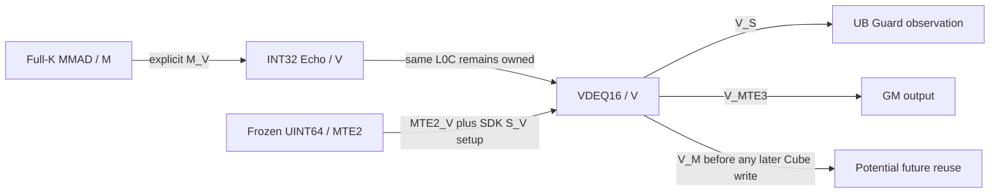

# External CO1 L0C bounded feasibility review

Decision: **BLOCKED — formal observation and independent CO1 resource admission
are missing**. Source progress is real: the explicit dav_2002 M→V completion edge
has been found; a missing event is no longer the blanket explanation. This is
not a claim that External CO1 is unsupported, nor a new NPU correctness result.
No compute Kernel, OPP or device Runner is created. No historical code or report
is changed. The supplied server results remain reported evidence until the new
read-only audit reads and verifies their bound files.

## 1. Formal50-field observation

The existing actual SDK serializer maps50 fields into200 bytes. That proves how
to decode a captured TCube blob, not how to obtain an uncaptured formal blob.
The prior reports contain50 **standalone** fields and27 **formal** fields. This
review does not populate the remaining23 formal fields from standalone values.

The reviewed public ACLNN boundary returns Workspace size and an opaque
`aclOpExecutor` (acl_meta.h49). It does not expose a TilingContext or serialized
TCube getter. `gert::TilingContext::GetRawTilingData()` and `GetPlatformInfo()` are
accessible inside the runtime-created registered callback, not through the
opaque executor returned to the Host caller. The historical Op Host sources
write the outer Tiling struct there, but their public GetWorkspaceSize interface
does not return it. Calling the old callback with ContextFaker, a hand-built
context or Manager capacities would not be a new formal measurement.

A host-only observer of the real serialization boundary could be a future route
without changing OPP bytes, for example a narrowly audited serialization
interposer. It has **not** been established here: symbol/ABI resolution,
interception of both outer/inner serialization, post-write buffer ownership,
thread/reentrancy behavior, and preservation of the original callback return
must all be verified. This delivery neither guesses executor offsets nor enables
LD_PRELOAD instrumentation. Thus complete formal50-field capture is **BLOCKED**,
not declared impossible for every conceivable diagnostic mechanism.

A proposed observer would run the two historical private OPPs in separate
Host-only processes, verify original OPP/Host/API/SDK identities, invoke only
GetWorkspaceSize, capture the runtime-produced bytes and real Core/Workspace
plan, hash them, and check the27 recorded values against the decoded50 fields.
Missing capture, unexpected class/size, multiple contradictory blobs or any
execute call would reject the observation. Nothing would be written into either
historical experiment. This is an observer specification, not an implemented
formal Host probe or permission to fabricate PlatformInfo.

## 2. Source identities and ownership

`sdk-review.json` contains exact installed paths relative to
`/usr/local/Ascend/cann-9.0.0`, full SHA256 and line ranges. `run_review.py` hashes
only those direct dependencies, checks the existing CANN9.0.0 release bindings,
and records canonical paths. New event/interface identities are initially local
observations; running the same audit on the server is required before using them
as server-matched evidence. No SDK source snapshots are stored here.

| Contract | Source ID / lines | Finding |
|---|---|---|
| External binding | base648–658 | Only physical-L0C CType enters SetTensor; NZ and matching L0cT are required |
| Actual producer | scheduler93–122,164–206 | ScheduleOnce selects multi-K Compute for CFG_NORM; CubeCompute writes CubeOutBuffer tensor |
| Caller ownership | external29–65 | SetTensor copies the tensor handle; Alloc/Get return it; Init/EnQue/Free/Destroy add no queue/allocation/completion behavior |
| Ordinary output contrast | normal_queue38–81 | Normal queue allocation/EnQue/DeQue/FreeAllEvent behavior is absent from the external specialization |
| End | base459–462; scheduler_base149–167 | Cleans input/bias/L0 state and invokes output/quant Destroy; no explicit external-C M_V wait is credited |
| `sync=true` caveat | base649–658 | The external overload does not use the sync template argument to insert a wait; its spelling is not completion proof |
| Legal allocation API | tpipe298–347,920–935 | TBuf<CO1> gets a physical-pool range, rounded to32B; pool starts at0. Capacity asserts are debug-only, so actual Host capacity checks remain mandatory |
| Registration high-water | scheduler_base91–110; share_allocator220–246 | CO1 CType forces effective SDK shared L0C size to0; allocate caller CO1 before registration, keep it alive and avoid pool reset/reinitialization |
| Shared UB | share_getter206–217 | dav_2002 effective shared UB reservation is0 even when the raw field is nonzero |

The smallest proposed active CO1 tensor is4096 int32 =16384B. Allocate it first
in a fresh L0C pool, start0, before Matmul registration; start0 meets both32B and
conservative1024B matrix alignment. A general TBuf allocation only rounds to32B:
it does **not** guarantee1024B alignment after arbitrary earlier allocations.
Reject another L0C allocation, a different start, overlap or capacity failure.
Keep the same TPipe and buffer alive through all consumers; the conservative
review constraint retains End after those consumers have completed; no ResetPool/Init or
rebinding may occur. The external specialization's empty Destroy does not imply
the caller may destroy its buffer early.

## 3. Concrete completion and visibility edges

The inspected event implementation maps L0C→UB on dav_2002 to M_V/V_M
(event572–575). SetFlag(M_V) calls SetFlagInternal<PIPE_M,PIPE_V>
(event902–904); WaitFlag(M_V) calls WaitFlagInternal<PIPE_M,PIPE_V>
(event1043–1046). These reach set_flag/wait_flag for this architecture
(event291–327). The reverse V_M maps V→M. These are explicit SDK mappings,
not inferred from the enum name alone. Datacopy's L0C→UB INT32 and VDEQ16
operations use the Vector transfer path; VDEQ16's S_V wait configures its
coefficient register and does not replace M_V producer completion.

| Producer → consumer | Buffer | Required proof/edge |
|---|---|---|
| Last Full-K MMAD(M) → Echo(V) | CO1 | Explicit matched M_V after all issued MMAD work |
| GM Scale load(MTE2) → VDEQ16(V) | Separate UINT64 UB | Matched MTE2_V; frozen words, alignment and lifetime maintained |
| Echo(V) → VDEQ16(V) | Same read-only CO1, distinct UB outputs | Preserve serial V/PIPE_ALL ordering; no writer/reset/rebind |
| V consumers → scalar Guard reads | UB | V_S completion/visibility |
| V consumers → GM copy(MTE3) | Echo/FP16 UB | V_MTE3 completion |
| Last V consumer → next Cube overwrite | CO1 | Matched V_M; no overwrite in initial single-result scope |
| End → reader | Caller CO1 | End alone supplies none of the above completion claims |

`AllocEventID` reserves a pool bit; `ReleaseEventID` releases it
(tpipe443–464). FetchEventID only finds a free bit (467–484), so it is not a
persistent reservation. Future code must check actual event IDs, reserve without
collision, consume each signal before releasing/reusing the ID, and retain all
existing required barriers. Syntax checking the APIs is not a device proof.



Echo and VDEQ16 read the same unchanged CO1 allocation; neither changes CType or
reloads an approximated integer value. The exact16×256 coverage is conditional
on an actual accepted one-result singleCore/base16/256, fullK2560 Tiling.
NZ index `(n//16)*256+m*16+n%16` is a4096-element bijection. Each N16 block is256
int32 (1024B); each VDEQ16 result is256 half (512B), with128B of original Scale
words. This only establishes the intended geometry. New CO1 Tiling is still
required; VECIN coverage reports cannot certify that configuration.

## 4. Resource and formal Host-only specification

No CO1 Formal TilingContext has been queried. `conditional_budget()` evaluates
provided fields as a CPU equation check and can never return HOST_FEASIBLE.
It rejects incomplete capacities, shape/base drift, invalid steps/depth/db,
unexplained L1 totals, L0 overflow, scratch overflow and a nonzero external-C
start. Fixture numbers in tests are not actual CO1 resource measurements.

| Planned item | Bytes / rule |
|---|---|
| Scratch ceiling |202240, unchanged ceiling; actual new transLength must fit |
| Raw Echo UB |16384 |
| Frozen Scale UB |2048, separate from scratch; not double-counted as SDK quant workspace |
| FP16 UB |8192 |
| Four prefix/suffix Guard pairs |2048 |
| Untouched Reserve |8192 |
| Total UB design |239104; compare against actual Formal UB capacity |
| Caller L0C |16384 at0; effective SDK shared-L0C reservation0 for this CType |
| L1 |Actual base-A/B tile bytes×actual depths; verify shareL1Size represents that footprint, not an extra duplicate |
| L0A/L0B |Actual base dimensions×db factors; do not assume headroom beyond L0B65536 |
| GM Workspace |Actual platform system reservation plus separately guarded arena; validate actual ACLNN request and offsets |

A permitted future Host-only probe must receive PlatformInfo from a **real
runtime-created formal callback**, log the actual device/architecture/aic/aiv/all
policy, use BlockDim1 without substituting Manager8 cores, request INT8 GM ND A/B,
INT32 CO1 NZ C, no bias or Matmul dequant setter, and evaluate M16/N256/K2560,
base16/256/128 with scratch ceiling202240. The256 UINT64 words belong to the
manual VDEQ16 consumer, not a new quantized Matmul output type. It must capture
all50 actual fields, capacities, effective shared-memory consumption, actual
workspace request and allocation ranges before any execution is considered.
It must reject setup/GetTiling errors, unknown consumers, changed base or resource
failures. This specification cannot be run through a fabricated Context or
promoted from the prior VECIN resource report.

The absence of an admitted formal callback/observation route under the current
no-new-OPP restriction is the remaining Host blocker. We do not produce a new
execution design under task4's gate until that and the full resource contract
are independently accepted. Echo-all4096, two-repeat FP16 comparisons, original
Scale, Poison/Readonly/GM+UB Guard and L0C range verification remain mandatory
acceptance requirements, not results already obtained.

## 5. shareUbSize, transLength and Workspace

The supplied standalone observation is shareUbSize2048 vs0. The audit re-decodes
the bound200B files and confirms or rejects that observation rather than trusting
the summary. Both paths consume effective shared UB0 on dav_2002. That does not
mean the original FP16 coefficient storage is absent: QuantProcessor obtains its
view at transLength inside the explicitly supplied scratch, then copies256
uint64 words (2048B). Raw INT32 has no such quant vector. Numeric equality between
the raw shareUbSize field and vector byte size is not by itself an allocation
proof; the actual consumers/getter are the evidence.

transLength is an UB scratch offset/extent, shareL1Size describes L1 space, and
GetLibApiWorkSpaceSize/ACLNN Workspace describe GM reservations. These address
spaces must not be summed or substituted for one another. Prior reports remain
reference evidence only; they do not establish the new CO1 resources.

## 6. Run and results

Local CPU checks and syntax-only API instantiation:

```bash
D=framework/custom_ops/draft_w8a8_output_dequant/stage4v_external_co1_review
PYTHONPATH=framework/custom_ops/draft_quant/test python3 -B -m pytest -q -p no:cacheprovider "$D/test"
# Existing ARM64 CANN Docker, new directory only:
bash "$D/local_check/check.sh" /work/build/NEW_EXTERNAL_CO1_REVIEW
```

Server **read-only** audit, from repository root:

```bash
git pull --ff-only
export CANN_ROOT=/usr/local/Ascend/cann-9.0.0
D=framework/custom_ops/draft_w8a8_output_dequant/stage4v_external_co1_review
OUT=/home/w00949577/qwen35-dflash-run/w8a8-external-co1-review-$(date +%Y%m%d-%H%M%S)
python3 -B "$D/run_review.py" --cann-root "$CANN_ROOT" \
  --evidence-root /home/w00949577/qwen35-dflash-run/w8a8-vdeq16-review-20261109-031709 \
  --output-dir "$OUT"
```

Exit2 means the audit completed but execution admission is BLOCKED. Exit1 means
source/evidence validation failed; inspect the error. Neither exit means Host or
NPU PASS. The command initializes no ACL/device API and loads no custom OPP.
Return `review-report.json`, `formal-tiling-feasibility.json`,
`dependency-report.json`, `resource-design.json`. Original FP16/Raw/Stage4V
reports, Golden, tolerances, SDK and all historical OPP remain unchanged. There
is no benchmark, new Golden, UB→L0C injection or device execution.
