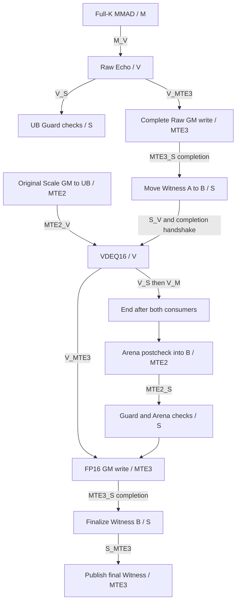

# Spatial and temporal resource contract

All intervals are half-open bytes. External CO1 stays `[0,16384)` in its separate
L0C address space,1024B-aligned, live through both consumers. No UB→L0C injection
or L0C Canary allocation is introduced. Coverage remains
**RANGE_ONLY_NO_CANARIES**, including after any future numerical match.

## UB map

| Buffer | Prefix | Payload | Suffix |
|---|---|---|---|
| Scratch202240 |[0,256)|[256,202496)|[202496,202752)|
| Echo16384 |[202752,203008)|[203008,219392)|[219392,219648)|
| Scale2048 |[219648,219904)|[219904,221952)|[221952,222208)|
| FP168192 |[222208,222464)|[222464,230656)|[230656,230912)|

Payload228864 + guards2048 =230912 explicit bytes. Preserve8192 Reserve;
accounted total239104 <=262144. The unallocated margin23040 is not permission
to add buffers. Reserve remains at the top `[253952,262144)`; no object/view
may enter it. Guard coverage is8 regions×256B =512 uint32 words. GM buffers
receive their separate existing GuardedBuffer redzones; GM Workspace reference
4195328 is a different address space, not UB/L1 budget.

Scale vector j uses physical `[219904+128*j,219904+128*(j+1))` for j=0..15;
the last endpoint is221952, immediately before its suffix Guard. FP16 transfers
use `[222464+512*j,222464+512*(j+1))`; last endpoint230656 is before its suffix.
A/B stay original GM inputs. All input identities and runtime readonly checks
remain mandatory; no new activation or weight quantization exists.

## Proposed alias relocation

Phase1's aliases cannot remain inside FP16 during VDEQ16. Proposed relocation:

| View | Before Raw publication (A) | After completed Raw publication (B) |
|---|---|---|
| Arena temporary512B |FP16 payload[0,512), absolute[222464,222976)|Echo payload[0,512), absolute[203008,203520)|
| Witness256B |FP16 payload[512,768), absolute[222976,223232)|Echo payload[512,768), absolute[203520,203776)|

Only after the entire Raw Echo UB→GM operation has **completed** may Echo UB be
repurposed. Use MTE3_S to make its completion visible to the Scalar migration.
Copy all32 UINT64 metadata words using S GetValue/SetValue from Witness A to B;
then use S_V to order completion of those Scalar reads before VDEQ16 writes
all8192B of FP16. A concrete completion handshake such as a following V_S is
required before releasing/reusing the app's S_V ID or entering the SDK's own
Fetch(S_V) sequence. CPU control flow alone is not that handshake.

This is metadata movement, not a Float/Scale calculation. It requires no new
TBuf, UB or L0C allocation. No copy of the4096 numerical Echo values is needed
inside UB after the complete, guarded GM Echo has been published. GM Raw remains
immutable until Host inspection. After migration, no function may keep a stale
Witness A or Arena A view. Guard checks must receive the active Witness B handle.
Failure after early Raw publication does not permit an overall PASS.

## Nominal dependency/lifetime schedule for review

1. Allocate the same buffers, external CO1 first. Check actual addresses/ranges,
   initialize Guards and Witness A. Initial Arena operations use A only. Scale
   GM→UB completes with MTE2_V; no later Scale writer exists.
2. Preserve original Matmul setup and Full-K Iterate(false, externalCO1).
   Explicit M_V closes the Cube producer before Raw Echo/VDEQ16 can read CO1.
3. Raw Echo DEQ_NONE fills Echo UB. V_S closes writes before Guard inspection.
   V_MTE3 enables the complete ND Raw write to GM. End is not called yet.
4. MTE3_S completes that Raw GM copy. Migrate Witness A→B on S; retire all A
   aliases. S_V (and completion handshake for event reuse) makes the FP16 payload
   available to V. Scalar metadata updates thereafter use B only.
5. VDEQ16 reads the same unchanged CO1 and frozen Scale, one N16 block at a time.
   Each call retains SDK S_V coefficient-register setup. No intervening MMAD,
   buffer reset, CO1 rebind or new CType operation is allowed.
6. V_S closes both V readers/output writes before Guards. Preserve V_M after
   the last reader and all required PIPE_ALL/PIPE_V barriers. Then End, with
   external CO1/TPipe still alive. Do not use End as the completion mechanism.
7. Workspace Arena postcheck uses B temporary only, with MTE2_S before Scalar
   comparison. Raw GM already owns the integer result. FP16 UB is untouched by
   Arena/Witness. V_MTE3 orders its complete ND GM output; MTE3_S completes it.
8. Only now finalize Witness B success/coverage flags, S_MTE3 publish it, and
   drain all output work before freeing/reusing buffers/events or returning.
   Keep source/target guards and readonly/Poison/Repeat checks on the Host.

| Buffer/view | Producer | Last consumer / release condition |
|---|---|---|
| Scratch |SDK input preparation/Matmul |SDK lifecycle through End; no app alias |
| CO1 |Full-K Cube |Echo + VDEQ16 read completed; V_S/V_M before End; caller lives to terminal completion |
| Echo numeric |Echo V copy |Full Raw GM MTE3 completed, observed via MTE3_S |
| Echo aliases B |Scalar migration / Arena MTE2 |Witness publication + relevant S/MTE3/MTE2 completion; no Raw numeric reuse |
| Scale |initial MTE2 |last VDEQ16 read completed; immutable throughout |
| FP16 aliases A |initial Arena / Scalar metadata |Raw published; Scalar migration completed before S_V permits overwrite |
| FP16 numeric |VDEQ16 V |FP16 GM MTE3 completion, then terminal checks |
| UB redzones |initial V initialization |every planned boundary check; never payload storage |
| GM Raw/FP16/Witness |device DMA |Host readback after stream sync; exact comparison and Repeat |

## Events: source mappings, not simulated hardware evidence

Mappings and exact hashes are in `sdk-review.json`, principally event.h and
kernel_tpipe_impl.h. Additions are **MTE3_S** (RAW DMA→Scalar reuse) and **S_V**
(Scalar migration→Vector overwrite). Existing eight dependencies remain.

MTE3_MTE2 remains required for initial Arena writes→reads. V_M protects any
future Cube overwrite; there is no second MMAD in this diagnostic. V_S is
necessary before Scalar Guard reads; PIPE_V/PIPE_ALL are retained rather than
optimized away. The VDEQ16 wrapper's internal S_V orders its register setup,
not the original Cube producer or arbitrary prior DMA reuse.

### Still open before implementation

The above nominal sequence supplies explicit producer/consumer dependencies,
but a complete event-ID reservation/release and error-drain proof is still
required. Alloc/Fetch/check IDs in the actual selected SDK; no hard-coded ID.
Fetch is not reservation. SDK VDEQ16 Fetch(S_V) must have an available ID distinct
from any live app reservation. Do not release an app ID merely because C++ has
issued WaitFlag; prove the relevant wait/consumer completed. Do not reuse an ID
with a pending signal. Resource exhaustion after asynchronous work has started
must use an already verified drain path before buffer destruction, not early End.

This open resource/lifecycle issue is why overall implementation admission is
BLOCKED pending independent review. The CPU model uses explicit completion tokens
to test the *required ordering*, never to assert real device completion. A new
Formal Host is mandatory even with unchanged239104B accounting, because ABI,
output count, code identity, live aliases and consumers change. A changed actual
Workspace cannot be accepted by silently copying4195328 from Phase1.
