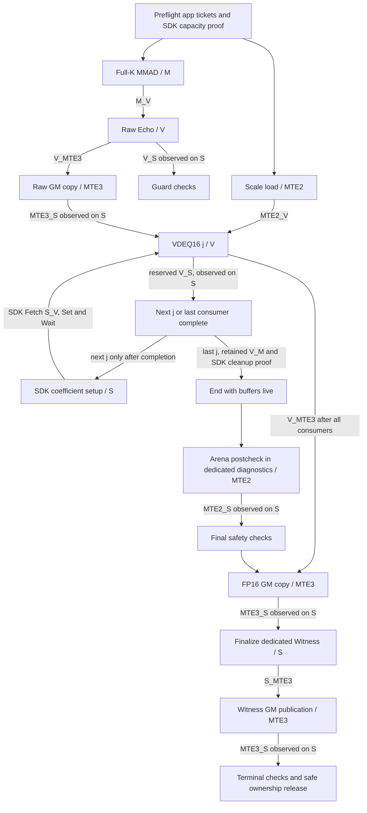

# Phase2.1 spatial, ownership and completion contract

Preferred design **B**, conditional and BLOCKED. Design A is retained as an
alternative in DESIGN_A_VS_B.md and the original `phase2_contract.layout()` CPU
model. No old source/experiment report is rewritten as a B resource admission.
Source identities: EVENT_OWNERSHIP_REVIEW.md (TP/EV/DC/QP); geometry and shared
resource evidence: SDK_CONTRACT.md / sdk-review.json. All intervals are half-open
bytes. These are proposed addresses; actual TPipe allocation remains NOT_RUN.

## UB / L0C / GM are separate ledgers

| UB buffer | Prefix Guard | Payload | Suffix Guard |
|---|---|---|---|
| Scratch202240 |[0,256)|[256,202496)|[202496,202752)|
| Echo16384 |[202752,203008)|[203008,219392)|[219392,219648)|
| Scale2048 |[219648,219904)|[219904,221952)|[221952,222208)|
| FP168192 |[222208,222464)|[222464,230656)|[230656,230912)|
| Diagnostics768 |[230912,231168)|[231168,231936)|[231936,232192)|

Diagnostics has disjoint Arena512 `[231168,231680)` and Witness256
`[231680,231936)` views, no numerical alias and no migration. Payload229632 +
Guards2560 =232192 explicit bytes. Reserve8192 remains `[253952,262144)`;
accounted total240384 <=262144, with21760 unallocated margin. Ten Guard regions
contain640 uint32 words. Existing four buffers, their addresses, Scratch202240,
all original barriers and mathematical operations are unchanged in the design.

A has four Guard pairs and total239104. It temporarily aliases metadata in
FP16, then Echo after Raw GM completes; its complete extra handoff obligations
are in EVENT_OWNERSHIP_REVIEW.md and FAILURE_DRAIN_REVIEW.md. It is not selected.

External CO1 remains `[0,16384)` in physical L0C,1024B aligned, live through Echo
and VDEQ16. Coverage is **RANGE_ONLY_NO_CANARIES**. No extra L0C is allocated.
Effective shared UB0 / external CO1 shared L0C0 must be reverified on the actual
path. GM Workspace4195328 is a historical reference, not UB/L1 allocation or a
new accepted request. New ABI and B allocation require new Formal Host admission.

Each j=0..15 Scale slice is `[219904+128*j,219904+128*(j+1))`; last endpoint221952.
FP16 slice is `[222464+512*j,222464+512*(j+1))`; last endpoint230656. Original
A/B/Scale bytes remain immutable. No weight/activation re-quantization occurs.

## B dependency graph — healthy operations, explicit completion observations

This does not authorize interleaving app S_V work with SDK Fetch. B has **no
manual S_V**. Require a valid free SDK S_V slot, freeze application same-pool
allocation/use, retain each SDK pair, and append a reserved V_S Scalar completion
join **after every N16 conversion**. A C++ call return alone is not a completion
witness. This is proposed diagnostic serialization, not a performance change or
executed result. No End, PIPE_ALL, PIPE_V or required event is deleted.

Arena initial writes/reads retain MTE3_MTE2 and MTE2_S. S_MTE3 protects Scalar
Witness publication; MTE3_S closes it before releasing resources. Manual IDs are
reserved before user asynchronous producers and retained until proved terminal
completion. Their effect on SDK peak event demand remains UNRESOLVED.

| Buffer | Producer | Last consumer / release condition |
|---|---|---|
| Scratch |SDK Matmul input/preparation|SDK lifetime and End prerequisites separately proved; no app alias|
| CO1 |Full-K M|both V consumers completed, retained reverse edge, SDK cleanup proof; no End-as-drain assumption|
| Echo |V DEQ_NONE|complete Raw GM MTE3 observed via MTE3_S; numeric view never repurposed|
| Scale |MTE2 load|last VDEQ16 read completed; no writer after initial load|
| FP16 |VDEQ16 V|last FP16 GM MTE3 completed and observed via MTE3_S|
| Arena diagnostics |MTE2 check reads|MTE2_S before Scalar comparison; fixed view|
| Witness diagnostics |S metadata|S_MTE3 then final publication MTE3_S; fixed view|
| UB Guards |initial V|all planned boundary checks; never payload storage|
| GM outputs |MTE3|successful execution/sync, Host Guard/readonly/Repeat checks; no partial PASS|

## Error exits are not unconditional release points

See FAILURE_DRAIN_REVIEW.md A–H matrix. Each failure tail must account for
**issued** work, retain live buffers, use pre-reserved completion tickets, then
meet the SDK cleanup prerequisites before End/release. Do not wait on a producer
never issued. Data validation failure and hardware no-progress failure have
different outcomes. The latter has no proved finite in-Kernel drain and must
never produce trusted success evidence.

Remaining gates: SDK peak per-event reservation demand with held app tickets;
SDK-owned MTE1/input-queue/L1/L0A/B error-path lifetime; independent review; B's
actual TPipe/Formal Host admission. A spatial budget or CPU completion token
cannot close these gates. Kernel implementation remains NOT_AUTHORIZED.
